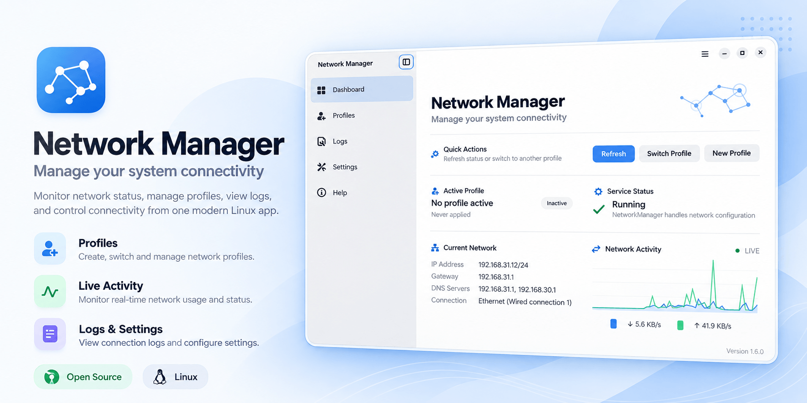

# Network Manager

<div align="center">



**Save your network settings as profiles and switch between them in one click.**

Made for Fedora with the GNOME desktop (tested on Fedora 44).

</div>

---

## What is it?

Do you move between home, the office and a café, and need different settings in
each place? Network Manager lets you save everything a place needs (IP address,
DNS, proxy, VPN, printer and more) as a **profile**. Pick a profile and the app
applies it for you. It can even switch profiles on its own when you arrive
somewhere.

## What it can do

- **Network**: IP addresses (automatic or fixed), DNS servers, routes, Wi-Fi and VPN connections
- **System**: hostname, proxy, firewall zone, default printer, timezone
- **Automatic switching**: change profile based on the Wi-Fi network, your router, or the time of day
- **Scheduling**: activate a profile at a set time
- **Connection watchdog**: get notified, or reconnect, when the connection drops
- **System tray**: show an icon and switch profiles from the tray (GNOME needs the AppIndicator extension)
- **Scripts**: run your own scripts before or after a profile is applied, optionally sandboxed
- **Privacy**: your profiles are stored only on your computer, optionally encrypted with a passphrase
- **Dashboard**: see your current connection at a glance
- Follows your GNOME light or dark style

## Install on Fedora

1. Download the latest `.rpm` file from the [Releases page](https://github.com/christosdaggas/Network-Manager/releases).
2. Install it:

   ```bash
   sudo dnf install ./network-manager-*.rpm
   ```

3. Open **Network Manager** from your app grid.

To remove it later: `sudo dnf remove network-manager`

## Getting started

1. Open **Profiles** and click **New Profile**.
2. Give it a name (for example "Office") and add the settings you need.
3. Click **Apply** to switch to it.
4. Optional: add rules so the profile turns on by itself when you connect to a certain Wi-Fi network.

## Build it yourself

```bash
sudo dnf install cargo rust gtk4-devel libadwaita-devel glib2-devel gettext-devel rpm-build
cargo build --release
./target/release/network-manager
```

To build your own RPM package, run `./scripts/package-rpm.sh`. The package is saved in `dist/rpm/`.

## Updates and privacy

The app checks GitHub once at startup to see if a newer version is available
and shows a small notice if there is one. Connection checks ping 8.8.8.8 (the
watchdog target can be changed in Settings), and the optional speed test
downloads a file from Cloudflare. The app does not collect or send any
personal data.

## Feedback and contributing

Found a bug or have an idea? [Open an issue](https://github.com/christosdaggas/Network-Manager/issues).
Want to help with the code? See [CONTRIBUTING.md](CONTRIBUTING.md).

## License

MIT. See [LICENSE](LICENSE).

## Author

**Christos A. Daggas**: [chrisdaggas.com](https://chrisdaggas.com) · [info@chrisdaggas.com](mailto:info@chrisdaggas.com)
